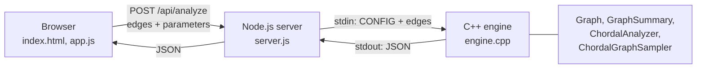

# Chordal Graph Explorer

**Streaming graph analysis and MCMC sampling of chordal graphs, with a C++ engine and an interactive web interface.**

A stream of edges goes into a C++ graph engine. The engine summarises the graph, finds its most connected nodes, extracts the subgraph around them, and then runs a Markov chain Monte Carlo (MCMC) sampler that walks through **chordal graphs** (graphs with no induced cycle longer than 3). A web page shows every stage and lets you replay the chain step by step.

https://github.com/user-attachments/assets/6d2eeb9e-4fbe-4cee-933c-3e92c0ca692a

---

## Contents
1. [What problem this solves](#1-what-problem-this-solves)
2. [How it works](#2-how-it-works)
3. [The five stages, with screenshots](#3-the-five-stages-with-screenshots)
4. [The key algorithms](#4-the-key-algorithms)
5. [How the web page talks to the C++ code](#5-how-the-web-page-talks-to-the-c-code)
6. [Run it yourself](#6-run-it-yourself)
7. [Example dataset and expected results](#7-example-dataset-and-expected-results)
8. [Project files](#8-project-files)
9. [Limitations and future work](#9-limitations-and-future-work)

---

## 1. What problem this solves

Real networks arrive as streams of edges (who connected to whom). Two questions follow:

1. **What does this graph look like?** Size, density, connected components, the most important nodes.
2. **What do random graphs with the same kind of structure look like?** Chordal graphs are an important class because many hard graph problems become easy on them, and they appear in probabilistic graphical models. This project samples from the space of chordal graphs by moving through it one edge at a time.

The project connects the two: it takes the neighbourhood of the highest-degree nodes in a real stream and uses it as the starting point of a chordal-graph sampler.

## 2. How it works



| Layer | Role |
|---|---|
| **C++ core** | All of the graph analysis and sampling. The original project code, unchanged in logic. |
| **`engine.cpp`** | A thin command-line wrapper. Reads edges on stdin, calls the core classes, prints one JSON object. |
| **`server.js`** | Validates input, enforces limits, starts the engine, returns its JSON to the browser. Uses only built-in Node modules. |
| **Web page** | Draws graphs on a canvas, charts as SVG, and replays the MCMC chain. No libraries. |

## 3. The five stages, with screenshots

The page follows the same five stages as the console program (`main.cpp`).

### Input panel
Paste edges as `u,v` pairs or upload a CSV. Choose how many top nodes to extract, how many MCMC iterations to run, how often to record the chain, and a random seed. The same seed and input always give the same chain.


### Stage 1: Stream ingestion and summary
Edges are loaded into the C++ `Graph`. The page shows node and edge counts, average degree, density, connected components, the maximum clique size, and whether the whole graph is chordal. Node size shows degree and the amber rings mark the top-K nodes. Hover any node for its degree and PageRank.


### Stage 2: Feature and component extraction
The top-K nodes by degree (these feed the next stage), the highest PageRank scores as a second view of importance, and the connected components.


### Stage 3: Induced subgraph for chordal analysis
The subgraph keeps the top-K nodes and every edge between them. The page reports whether it is chordal. If it is not, a warning explains that the chain starts outside the chordal set.


### Stage 4: MCMC walk over chordal graphs
This is the main view. Each recorded step of the chain can be shown on the graph. **Green** edges were added since the previous record and **red dashed** edges were removed. Use the slider or Play button to move through time, or click any chart to jump to that point. The four charts track edges, density, average degree and maximum clique size. The bar at the bottom shows how many proposals were accepted, rejected or could not be applied.


### Stage 5: Structural comparison
The raw stream, the extracted subgraph and the final state of the chain side by side. A `≈` before a clique size means the graph is not chordal, so the value is only an estimate (see [section 4](#4-the-key-algorithms)).


## 4. The key algorithms

### Is this graph chordal?
A graph is chordal if it has a **perfect elimination ordering**: an order of the vertices in which each vertex's later neighbours are all connected to each other. The code finds a candidate ordering with **maximum cardinality search** (MCS), then checks it.

**Step 1: Maximum cardinality search.** Repeatedly visit the unvisited vertex that has the most already-visited neighbours. The reverse of the visit order is the candidate elimination ordering.


**Step 2: Verify the ordering.** For every vertex, the neighbours visited before it must form a clique. If any pair of them is not connected, the graph is not chordal.


**Maximum clique size.** In a chordal graph, the largest clique equals the largest "earlier neighbours + 1" over all vertices, so it can be read straight from the same ordering. This is exact for chordal graphs. For other graphs it is only an estimate, which is why the page marks it with `≈`.

### The MCMC sampler
The chain keeps a current graph and repeats the following for every iteration:

1. Pick one of three moves at random: **add** an edge, **remove** an edge, or **toggle** a random pair of vertices.
2. Apply the move to a copy of the current graph.
3. If the move could not be applied (for example it picked the same vertex twice), count it as a *no-op*.
4. If the copy is chordal, **accept** it and move there. Otherwise **reject** it and stay.

Because every accepted state is chordal, the chain only ever visits chordal graphs.


## 5. How the web page talks to the C++ code

**The browser** sends the edge list and parameters to the server:


**The server** validates them, starts the C++ program, writes the edges to its standard input, and collects the JSON it prints:


**The engine** reads the edges, calls the same classes used by the console program, and prints the result:


### API
`POST /api/analyze`

```json
{ "edges": "1,2\n2,3\n3,1", "topK": 8, "iterations": 300, "logInterval": 10, "seed": 1 }
```

The response contains `stream` (summary and edge list), `nodes` (degree, PageRank, component for each node), `topK`, `communities`, `subgraph`, and `mcmc` (acceptance counts and one record per logged step, each with the full edge list so the page can replay it).

`GET /api/health` reports whether the C++ engine was found.

Server limits: 5,000 edges, 5,000 iterations, node ids up to 100,000, 30 second timeout.

## 6. Run it yourself

You need a C++17 compiler (g++) and [Node.js](https://nodejs.org) 18 or newer. There is no `npm install` step.

**1. Build the engine** (one command, from the project folder):

```bash
g++ -std=c++17 -O2 dsu.cpp graph.cpp graph_summary.cpp ChordalAnalyzer.cpp ChordalGraphSampler.cpp engine.cpp -o chordal_api.exe
```

On Linux or macOS use `-o chordal_api` instead.

**2. Start the server:**

```bash
node server.js
```

**3. Open** <http://localhost:3000>. The badge at the top right should read "C++ engine connected". Upload `data/graph_stream_30.csv`, set Top-K to 8, and press **Run analysis**.

Open the page through that address. Opening `index.html` directly from disk will not work because the page needs the server.

**Original console program** (optional):

```bash
g++ -std=c++17 -O2 dsu.cpp graph.cpp graph_summary.cpp ChordalAnalyzer.cpp ChordalGraphSampler.cpp main.cpp -o main.exe
```

### Parameters

| Setting | Meaning | Suggested |
|---|---|---|
| Top-K nodes | How many highest-degree nodes form the subgraph | 8 for the example data |
| MCMC iterations | Length of the chain | 300 |
| Record every | A snapshot is saved every N iterations | 10 |
| Random seed | Same seed and input give the same chain | 1 |

## 7. Example dataset and expected results

`data/graph_stream_30.csv` is a 30-node graph with 54 edges. It has three groups of ten nodes, each with a hub (nodes 1, 11 and 21), joined by a few bridge edges.

With Top-K = 8, 300 iterations, record every 10 and seed 1, you should see:

| Quantity | Value |
|---|---|
| Stream | 30 nodes, 54 edges, average degree 3.600, density 0.124, 1 component |
| Whole graph chordal? | No (maximum clique shown as ≈4) |
| Top-8 nodes by degree | 11, 1, 21, 5, 20, 18, 17, 16 |
| Extracted subgraph | 8 nodes, 11 edges, chordal |
| MCMC proposals | 300 total: 183 accepted, 55 rejected, 62 no-ops |

## 8. Project files

| File | Purpose |
|---|---|
| `graph.hpp`, `graph.cpp` | Graph with adjacency sets, degrees, top-K, PageRank, components, induced subgraphs |
| `dsu.hpp`, `dsu.cpp` | Disjoint set union used for community grouping |
| `graph_summary.hpp`, `graph_summary.cpp` | Node count, edge count, density, average degree |
| `ChordalAnalyzer.hpp`, `ChordalAnalyzer.cpp` | MCS ordering, chordality test, maximum clique size |
| `ChordalGraphSampler.hpp`, `ChordalGraphSampler.cpp` | MCMC sampler with a seed, accept/reject counters and snapshots |
| `main.cpp` | Original console program for the five stages |
| `engine.cpp` | JSON command-line wrapper used by the server |
| `server.js` | Node.js server between the page and the engine |
| `index.html`, `styles.css`, `app.js` | The web interface |
| `data/` | Example datasets |
| `docs/` | Screenshots and demo video used by this README |

## 9. Limitations and future work

- **The sampler is not proven to be uniform.** The remove move picks a random vertex and then one of its edges, which is not the exact reverse of the add move. Without a Metropolis-Hastings correction, the chain explores chordal graphs but its long-run distribution is not guaranteed to be uniform over them. Making the proposals symmetric, or adding the correction, is the natural next step.
- **The chain needs a chordal starting point.** If the extracted subgraph is not chordal, the chain can only move when a single edge change happens to produce a chordal graph. With a large Top-K it can get stuck. Starting from a chordal graph, such as a spanning tree of the subgraph, would remove this problem.
- **Maximum clique size is only exact for chordal graphs.** Other graphs get an estimate.
- **Scale.** Each iteration copies the graph and runs an O(n²) maximum cardinality search, which is fine for the sizes used here but not for very large subgraphs.
- **The stream is loaded in one batch.** The page does not yet show edges arriving over time.
